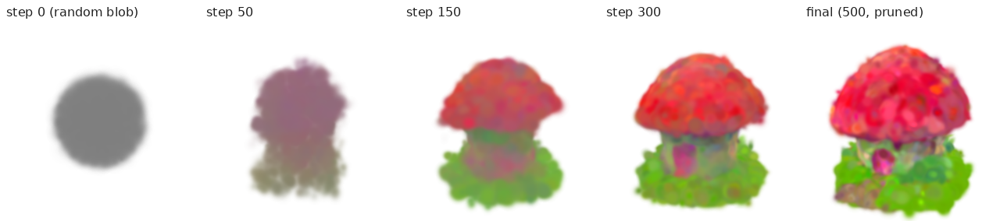

# Interactive Diffusion-Based 3D Generation Studio — Assignment 3 MVP

**CS 549 · Minh Quan Dao (qd66) · Graphics pillars: Procedural Generation + Rendering**

Text prompt → frozen Stable Diffusion 2.1 guidance (Score Distillation Sampling) → optimised **explicit 3D Gaussians**
(official [DreamGaussian](https://github.com/dreamgaussian/dreamgaussian), Tang et al., ICLR 2024) → real-time
novel-view rendering (CUDA rasterizer + my own WebGL2 Gaussian-splatting viewer) → measured stress test.

| | |
|---|---|
| Demo video (2–3 min) | `video/demo.mp4` → upload to YouTube/Vimeo: **TODO link** |
| Static web demo (GitHub Pages, read-only) | https://quandao10.github.io/diffusion-3d-studio/ (built from `docs/`) |
| Live studio (generation) | local NVIDIA GPU: `GPU=0 python server.py` → http://127.0.0.1:8549 |
| Report | `report/Assignment_3_Final.pdf` |

> **Plan vs. reality.** Assignment 2 specified an SDS-guided **NeRF** (differentiable volume rendering). This MVP keeps
> the same diffusion-guided loop — frozen 2D diffusion prior, random cameras, differentiable rendering, SDS gradients
> into a 3D representation, novel-view rendering — but optimises **3D Gaussians** with the official DreamGaussian code
> instead of a from-scratch NeRF, for speed and feasibility. It is *not* a NeRF and does *not* implement VSD/TRELLIS.



## What is mine vs. upstream

| Upstream (unmodified, pinned commit `69a3c70`) | Mine (this repo) |
|---|---|
| Gaussian model, densify/prune, SDS guidance (`guidance/sd_utils.py`), training step, PLY + mesh export, CUDA rasterizer (`diff-gaussian-rasterization`) | `scripts/train_logged.py` – wraps upstream `GUI.train_step` unchanged; logs SDS loss, timestep, per-parameter gradient norms, #Gaussians, peak VRAM, snapshots, views, turntable |
| | `scripts/benchmark_renderer.py` – stress test of the CUDA rasterizer (resolution / Gaussian count until OOM) |
| | `web/splat.js` – WebGL2 3D Gaussian splatting viewer (covariance → EWA projection, instanced quads, worker depth sort, premultiplied blending, GPU timer) |
| | `server.py` + `web/` – studio UI: prompt → GPU job, live progress/charts/log, viewer, stress tests |
| | `scripts/record_demo.py`, `scripts/tts.py` – demo-video capture (DevTools screencast) + voiceover |

The only change inside upstream is a one-line build fix (`#include <cfloat>` in `simple-knn/simple_knn.cu`, needed with
gcc 13 / CUDA 12.5), applied by `scripts/setup_env.sh`. The SD model key is passed to upstream's `StableDiffusion(hf_key=...)`
because `stabilityai/stable-diffusion-2-1-base` now returns HTTP 401; `Manojb/stable-diffusion-2-1-base` is a mirror of the same weights.

## Requirements

* Linux + NVIDIA GPU with ≥ 8 GB VRAM (tested: **A100-PCIE-40GB**, driver 560.28, CUDA toolkit 12.5 / nvcc, gcc 13.3, Ubuntu 24.04)
* conda, git, ffmpeg; ~10 GB disk (SD 2.1 weights ≈ 5 GB are downloaded from Hugging Face on first run)
* For the web viewer: any browser with WebGL2

## Build

```bash
git clone https://github.com/quandao10/diffusion-3d-studio.git && cd diffusion-3d-studio
CUDA_HOME=/usr/local/cuda-12.5 TORCH_CUDA_ARCH_LIST=8.0 bash scripts/setup_env.sh   # set the arch for your GPU (8.6 = RTX 30xx, 8.9 = RTX 40xx)
conda activate dreamgaussian
bash scripts/collect_env.sh            # writes evidence/environment.txt
```

`setup_env.sh` clones upstream DreamGaussian at the pinned commit into `third_party/`, creates the `dreamgaussian` conda env
(Python 3.10, torch 2.4.1+cu124, diffusers 0.27.2), and builds `diff-gaussian-rasterization`, `simple-knn`, `nvdiffrast`, `kiuikit`.

## Run

```bash
# 1) one text-to-3D run from the command line (≈ 2 min on an A100: 47 s SDS + mesh export + views)
GPU=0 bash scripts/run_text_to_3d.sh "a small red mushroom house" mushroom_house 0
#    -> results/mushroom_house/{mushroom_house_model.ply, *_mesh.obj, views/, progress/, turntable.mp4, metrics.jsonl, summary.json, training.log}

# 2) renderer stress test on the saved Gaussians
GPU=0 bash scripts/render_turntable.sh results/mushroom_house/mushroom_house_model.ply   # -> evidence/performance.csv

# 3) interactive studio (prompt -> live training monitor -> WebGL viewer -> stress tests)
GPU=0 python server.py --port 8549      # open http://127.0.0.1:8549  (ssh -L 8549:127.0.0.1:8549 for a remote GPU box)

# 4) static read-only site for GitHub Pages
python scripts/export_static.py         # -> docs/  (Settings → Pages → branch main, folder /docs)
```

## Public hosting (anyone can try a prompt)

```bash
bash scripts/serve_public.sh     # server (PUBLIC=1, 127.0.0.1 only) + Cloudflare quick tunnel; prints https://<random>.trycloudflare.com
bash scripts/stop_public.sh      # stop both
```

* **GPU scheduling:** every job is sent to an idle GPU on the machine (memory < 1 GB and utilisation < 10 %, not already
  running one of our jobs), so several visitors run in parallel. When all GPUs are busy the job waits in a FIFO queue and
  the visitor sees “All GPUs are busy – you are #N in line”. `GPUS=4,5,6,7` restricts the pool, `MAX_PARALLEL=n` caps it.
* **Visitor limits:** 1 generation per visitor per 24 h (salted hash of the IP, `run/visitors.json`), one active job at
  a time, prompts ≤ 120 characters plus a word blocklist (`configs/blocklist.txt`), ≤ 500 SDS steps, no mesh export
  (~1 min per job). Visitors' results go to `results/public/` and are shown only to them; the server prunes old ones.
* **Owner (admin):** requests from localhost without the tunnel header (e.g. via `ssh -L 8549:127.0.0.1:8549`) keep
  full settings, the CUDA stress test, and are not rate limited.
* The quick-tunnel URL changes whenever the tunnel restarts; it is written to `run/public_url.txt`.

## Verified results (A100-PCIE-40GB, 500 SDS steps, CFG 100, seed 0)

| prompt | SDS time | total (incl. mesh export) | final #Gaussians | peak VRAM |
|---|---|---|---|---|
| a small red mushroom house | 46.5 s | 122.6 s | 311,695 | 4.35 GB |
| a ripe pineapple | 46.3 s | 103.4 s | 293,427 | 4.81 GB |
| a wooden treasure chest | 46.9 s | 142.4 s | 298,342 | 4.33 GB |
| a cute corgi puppy | 46.7 s | 124.1 s | 312,254 | 4.34 GB |

Source: `results/*/summary.json`, `results/*/training.log` (includes `/usr/bin/time -v`). Gradient norms reaching
position / colour / opacity / scale / rotation are non-zero at every logged step (`results/*/metrics.jsonl`), i.e. the
diffusion guidance is back-propagated through the differentiable rasterizer into all Gaussian parameters.

Known limitations (visible in the outputs): soft/blurry splats and oversaturated, speckled colours typical of SDS with
CFG 100; the corgi shows the multi-face (“Janus”) artefact; no stage-2 mesh refinement was run.

### Stress test — CUDA Gaussian rasterizer (`evidence/performance.csv`)

Forward rendering of the mushroom-house Gaussians along a fixed 360° orbit (120 frames, 10 warm-up frames excluded,
`torch.cuda.synchronize` timing, peak VRAM via `torch.cuda.max_memory_allocated`, GPU 4 of the server, nothing else on it).

| axis | setting | Gaussians | FPS | peak VRAM |
|---|---|---|---|---|
| resolution | 256² | 311,695 | 314.7 | 0.14 GB |
| resolution | 512² | 311,695 | 368.2 | 0.22 GB |
| resolution | 1024² | 311,695 | 175.1 | 0.50 GB |
| resolution | 2048² | 311,695 | 57.8 | 1.50 GB |
| resolution | 4096² | 311,695 | 16.8 | 5.30 GB |
| count (512²) | ×4 clones | 1,246,780 | 144.6 | 0.78 GB |
| count (512²) | ×16 | 4,987,120 | 44.8 | 3.02 GB |
| count (512²) | ×64 | 19,948,480 | 11.7 | 11.97 GB |
| count (512²) | ×128 | 39,896,960 | 5.5 | 23.90 GB |
| count (512²) | ×256 | 79,793,920 | — | **CUDA OOM (failure point)** |

The Assignment 2 viewer target (≥ 30 FPS) is met up to 2048² and up to ~5 M Gaussians. The browser viewer has its own
sweep (×1…×16) in the studio; in headless Chrome on the server it rendered on a GPU shared with another user's job, so
its numbers are reported as indicative only.

## Repository layout

```
server.py                 studio backend (FastAPI): jobs on the GPU, progress, runs, nvidia-smi
web/                      studio front-end: index.html, app.js, splat.js (WebGL2 splatting), sort-worker.js, charts.js
scripts/                  setup_env.sh, collect_env.sh, run_text_to_3d.sh, train_logged.py, benchmark_renderer.py,
                          render_turntable.sh, export_static.py, record_demo.py, tts.py, demo_script.py, browser.py
configs/requirements_pinned.txt
evidence/                 environment.txt, setup logs, performance.csv, benchmark.log, debug/ (failed attempts kept)
results/<run>/            per-run outputs (large .ply/.obj are git-ignored; compact PLYs ship in docs/)
docs/                     static GitHub Pages build
video/                    demo.mp4, voiceover.wav, timeline.json, record.log
report/                   Assignment_3_Final.pdf + source
```

## Credits

DreamGaussian (MIT) © Jiaxiang Tang et al. — https://github.com/dreamgaussian/dreamgaussian · diff-gaussian-rasterization
(Inria/MPII Gaussian Splatting license, research use) · Stable Diffusion 2.1-base (CreativeML Open RAIL++-M) ·
Kokoro-82M TTS (Apache-2.0) used for the synthetic voiceover. AI assistance: Claude Code was used for environment
debugging, the wrapper/benchmark/viewer/studio code and documentation (see report, “AI Utility”).
